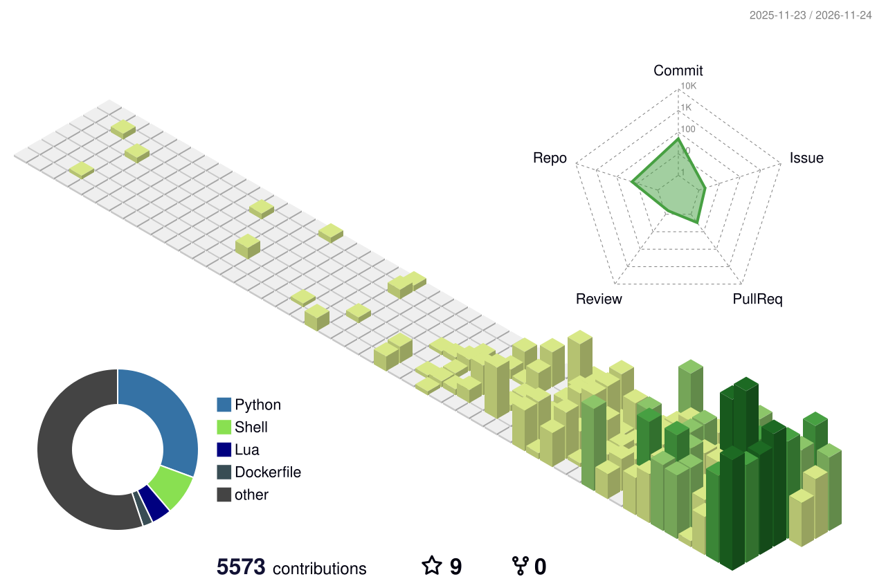

<h1 align="center">
  
</h1>

  <strong>Tech Lead · Especialista TOTVS Protheus · Engenharia de Software com IA</strong>

  

> **EN TL;DR** — Tech Lead and TOTVS Protheus specialist (ADVPL/TLPP) building software with AI: LLM agents, MCP and Claude Code wired into real delivery pipelines. Also TypeScript/Node, Angular and Python, and I run the infrastructure myself: Docker, PostgreSQL, Redis and Caddy.

---

## 👋 Sobre mim

- 🔭 **Especialista TOTVS Protheus** — ADVPL, TLPP e APIs REST.
- 🤖 **Engenharia de software com IA** — agentes com LLM, MCP e Claude Code integrados ao fluxo de entrega: issue, código, revisão e CI.
- 👨‍💻 **Fullstack**: TypeScript/Node e Angular (PO UI), Python para automação e serviços.
- 🛠 Infra é parte do trabalho, não um detalhe: opero minhas aplicações e bancos em servidores próprios com **Docker, Linux, PostgreSQL, Redis e Caddy**, com Cloudflare na borda.
- 📍 São Paulo – SP · remoto.
- ⚡ Trilogia favorita: *O Senhor dos Anéis*.

---

## 🛠 Stack

**TOTVS Protheus**

**IA**

**Web & Backend**

**Infra & DB**

---

## 🚀 Projetos

  

---

## 📊 Dashboard

<table align="center">
  <tr>
    <td>
      
    </td>
    <td>
      
    </td>
  </tr>
  <tr>
    <td colspan="2">
      
    </td>
  </tr>
</table>

  <picture>
    <source media="(prefers-color-scheme: dark)" srcset="./profile-3d-contrib/profile-night-view.svg" />
    
  </picture>

---

## 📬 Vamos conversar

Aberto a conversar sobre projetos TOTVS Protheus, desenvolvimento fullstack ou infra self-hosted. Me chama no LinkedIn ou manda um e-mail.

  
  

  

